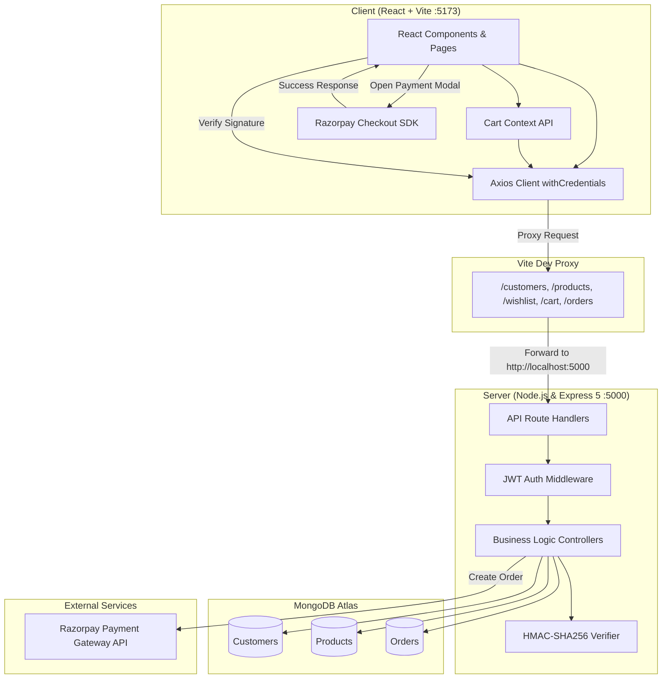

# 🛒 ShopKart — Fullstack MERN E-Commerce Platform

[](https://react.dev/)
[](https://vitejs.dev/)
[](https://nodejs.org/)
[](https://www.mongodb.com/)
[](https://razorpay.com/)
[](LICENSE)

**ShopKart** is a modern, responsive, fullstack e-commerce web application built with the **MERN** stack (MongoDB, Express.js, React, Node.js) and bundled using **Vite**. Developed across progressive educational lab modules (**Labs 1–6**), the application demonstrates industry-standard patterns including HttpOnly cookie-based JWT authentication, global state management via React Context, transactional order processing with inventory synchronization, and secure Razorpay payment gateway integration with HMAC-SHA256 signature verification.

---

## 📑 Table of Contents

- [Features](#-features)
- [Lab Progression Roadmap](#-lab-progression-roadmap)
- [System Architecture](#-system-architecture)
- [Tech Stack](#-tech-stack)
- [Project Directory Structure](#-project-directory-structure)
- [API Endpoints Reference](#-api-endpoints-reference)
- [Environment Variables](#-environment-variables)
- [Getting Started](#-getting-started)
  - [Prerequisites](#prerequisites)
  - [1. Backend Setup](#1-backend-setup)
  - [2. Database Seeding](#2-database-seeding)
  - [3. Frontend Setup](#3-frontend-setup)
- [Razorpay Payment Flow (Test Mode)](#-razorpay-payment-flow-test-mode)
- [Scripts Reference](#-scripts-reference)
- [Contributing & License](#-contributing--license)

---

## ✨ Features

### 🔐 Customer Authentication & Profile
- **Secure Authentication**: User registration and login with passwords hashed using **bcrypt** (salt rounds: 10).
- **Session Management**: Stateless authentication with **JWT** tokens stored in **`HttpOnly` cookies** to protect against XSS attacks.
- **Protected Routes**: Middleware verification across sensitive API endpoints (`/customers/me`, `/cart`, `/wishlist`, `/orders`).
- **Profile Customization**: Dedicated Settings page to update personal information and passwords.

### 🛍️ Product Catalog & Discovery
- **Comprehensive Listings**: Grid display of products with high-resolution imagery, pricing, category badges, and real-time stock indicators.
- **Search & Filtering**: Instant keyword search, category filtering (Electronics, Fashion, Books, Home), and price sorting (low-to-high, high-to-low).
- **Product Details**: Dedicated product view with dynamic stock status, quantity bounds, and one-click actions.

### ❤️ Wishlist (Lab 4)
- **User-Specific Wishlist**: Persistent saved-for-later items associated with the customer profile in MongoDB.
- **Instant State Toggle**: Add and remove items with real-time UI synchronization.

### 🛒 Shopping Cart & Global State (Lab 5)
- **Centralized Cart Context**: Persistent cart state managed through React Context API with live badge counts in the navigation bar.
- **Stock Guardrails**: Prevents users from adding more items than currently available in warehouse inventory.
- **Cart Calculations**: Automated calculation of subtotal, tax, and order grand totals.

### 💳 Checkout & Razorpay Integration (Lab 6)
- **Delivery Information**: Multi-field shipping address capture (name, phone, address, city, state, pincode).
- **Two-Step Order Lifecycle**: Server generates a Razorpay order in INR paise and creates a pending local order record before checkout.
- **Cryptographic Verification**: Validates Razorpay payments using **HMAC-SHA256** signatures (`orderId|paymentId`) to ensure tamper-proof transactions.
- **Inventory & Cart Cleanup**: Automatically decrements product stock and clears the customer's cart upon verified payment.

### 📦 Order History & Tracking (Lab 6)
- **Order Snapshots**: Preserves purchased product names, prices, images, and quantities at time of purchase.
- **Order Status Tracking**: Color-coded badges for order lifecycle states (`PENDING_PAYMENT`, `PLACED`, `CONFIRMED`, `SHIPPED`, `DELIVERED`).
- **Detailed Order Invoices**: Individual order detail pages detailing items, payment identifiers, and shipping address.

---

## 🗺️ Lab Progression Roadmap

This project was built incrementally across six lab milestones:

| Lab | Milestone | Core Implementations |
| :--- | :--- | :--- |
| **Lab 1** | **Backend Foundation** | Express server setup, MongoDB Atlas connection, Customer & Product models, initial REST controllers. |
| **Lab 2** | **Authentication & Security** | User registration, bcrypt hashing, JWT issuance, HttpOnly cookie handling, `authMiddleware`. |
| **Lab 3** | **Frontend Core & Catalog** | Vite + React setup, React Router v7, Navbar, Product cards, search and filter logic. |
| **Lab 4** | **Wishlist System** | Wishlist schema in Customer model, `/wishlist` endpoints, UI toggle and dedicated Wishlist page. |
| **Lab 5** | **Cart & State Management** | Embedded cart schema with quantity limits, `CartContext` provider, cart page with quantity update and deletion. |
| **Lab 6** | **Checkout, Razorpay & Orders** | Shipping form, Razorpay checkout modal SDK, HMAC-SHA256 signature verification, inventory decrement, order history and detail pages. |

---

## 🏗️ System Architecture



---

## 💻 Tech Stack

### Frontend
- **Framework**: [React 19](https://react.dev/)
- **Bundler & Tooling**: [Vite 8](https://vitejs.dev/)
- **Routing**: [React Router DOM v7](https://reactrouter.com/)
- **HTTP Client**: [Axios](https://axios-http.com/) (configured with `withCredentials: true`)
- **Styling**: Pure CSS with responsive modular design and glassmorphism styling
- **Payment SDK**: Razorpay Checkout SDK (`https://checkout.razorpay.com/v1/checkout.js`)

### Backend
- **Runtime**: [Node.js](https://nodejs.org/) (ES Modules)
- **Web Framework**: [Express.js 5](https://expressjs.com/)
- **Database ODM**: [Mongoose 9](https://mongoosejs.com/)
- **Authentication**: [JSON Web Token (jsonwebtoken)](https://jwt.io/), [bcrypt](https://www.npmjs.com/package/bcrypt), [cookie-parser](https://www.npmjs.com/package/cookie-parser)
- **Payment Processing**: [Razorpay Node SDK](https://github.com/razorpay/razorpay-node)
- **Environment Management**: [dotenv](https://www.npmjs.com/package/dotenv)
- **Dev Utility**: [nodemon](https://nodemon.io/)

---

## 📁 Project Directory Structure

```text
ShopKart_Lab/
├── .gitignore
├── README.md                      # Workspace documentation
├── front-end/
│   └── vite-project/
│       ├── index.html             # HTML entry point with Razorpay SDK script
│       ├── package.json           # Frontend dependencies and scripts
│       ├── vite.config.js         # Vite configuration with API proxy
│       └── src/
│           ├── main.jsx           # React DOM root render
│           ├── App.jsx            # Application router & routes
│           ├── App.css            # Component and layout styling
│           ├── components/
│           │   ├── Navbar.jsx     # Navigation bar with live cart count
│           │   ├── ProductCard.jsx# Reusable product card with wishlist & cart actions
│           │   └── SearchBar.jsx  # Search & category filter component
│           ├── context/
│           │   └── CartContext.jsx# React context for global cart state
│           ├── pages/
│           │   ├── Login.jsx      # Customer login page
│           │   ├── Register.jsx   # Customer registration page
│           │   ├── Products.jsx   # Product catalog and filter view
│           │   ├── ProductDetails.jsx # Detailed single product view
│           │   ├── Wishlist.jsx   # Saved items page (Lab 4)
│           │   ├── Cart.jsx       # Cart & item quantity adjustments (Lab 5)
│           │   ├── Checkout.jsx   # Shipping address & Razorpay checkout (Lab 6)
│           │   ├── MyOrders.jsx   # User order history (Lab 6)
│           │   ├── OrderDetail.jsx# Order summary & status tracking (Lab 6)
│           │   └── Settings.jsx   # Profile details & password update
│           └── services/
│               └── api.js         # Axios instance configured with credentials
└── server/
    ├── .env                       # Environment configuration (not committed)
    ├── .env.example               # Environment template
    ├── index.js                   # Express application entrypoint
    ├── package.json               # Backend dependencies and scripts
    ├── seed.js                    # Database seed script with sample inventory
    ├── fixImage.js                # Image repair utility script
    ├── controllers/
    │   ├── customer.controller.js # Auth and customer profile handlers
    │   ├── product.controller.js  # Catalog browsing and product CRUD
    │   ├── wishlist.controller.js # Wishlist management (Lab 4)
    │   ├── cart.controller.js     # Cart state management (Lab 5)
    │   └── order.controller.js    # Razorpay order, payment verification, order history (Lab 6)
    ├── middlewares/
    │   └── auth.middleware.js     # JWT token verification from HttpOnly cookie
    ├── models/
    │   ├── customer.model.js      # Customer schema with embedded cart & wishlist
    │   ├── product.model.js       # Product schema (name, price, stock, category)
    │   └── order.model.js         # Order schema with item snapshots & payment tracking
    ├── routes/
    │   ├── customer.routes.js     # /customers routes
    │   ├── product.routes.js      # /products routes
    │   ├── wishlist.routes.js     # /wishlist routes
    │   ├── cart.routes.js         # /cart routes
    │   └── order.routes.js        # /orders routes
    └── utils/
        └── generateToken.js       # JWT generation helper
```

---

## 🔌 API Endpoints Reference

### 👤 Customer Endpoints (`/customers`)
| Method | Endpoint | Auth Required | Description |
| :--- | :--- | :---: | :--- |
| `POST` | `/customers/register` | No | Register a new customer account |
| `POST` | `/customers/login` | No | Authenticate user and issue HttpOnly JWT cookie |
| `GET` | `/customers/me` | **Yes** | Retrieve currently logged-in customer profile |
| `POST` | `/customers/logout` | **Yes** | Clear session cookie |
| `PUT` | `/customers/settings` | **Yes** | Update customer full name or password |

### 📦 Product Endpoints (`/products`)
| Method | Endpoint | Auth Required | Description |
| :--- | :--- | :---: | :--- |
| `GET` | `/products` | No | Fetch all products (supports `?search=`, `?category=`, `?sort=`) |
| `GET` | `/products/:id` | No | Get single product details by MongoDB `_id` |
| `POST` | `/products` | No | Create a new product listing |

### ❤️ Wishlist Endpoints (`/wishlist` — Lab 4)
| Method | Endpoint | Auth Required | Description |
| :--- | :--- | :---: | :--- |
| `GET` | `/wishlist` | **Yes** | Fetch current user's wishlisted items |
| `POST` | `/wishlist/:productId` | **Yes** | Add a product to the user's wishlist |
| `DELETE` | `/wishlist/:productId` | **Yes** | Remove a product from the user's wishlist |

### 🛒 Cart Endpoints (`/cart` — Lab 5)
| Method | Endpoint | Auth Required | Description |
| :--- | :--- | :---: | :--- |
| `GET` | `/cart` | **Yes** | Fetch cart items populated with current product data |
| `POST` | `/cart/:productId` | **Yes** | Add product to cart or increment quantity |
| `PATCH` | `/cart/:productId` | **Yes** | Update item quantity (`{ quantity: number }`) |
| `DELETE` | `/cart/:productId` | **Yes** | Remove an item completely from the cart |

### 💳 Order & Payment Endpoints (`/orders` — Lab 6)
| Method | Endpoint | Auth Required | Description |
| :--- | :--- | :---: | :--- |
| `POST` | `/orders/create-payment-order` | **Yes** | Validate stock, create pending order, initialize Razorpay order |
| `POST` | `/orders/verify-payment` | **Yes** | Verify HMAC signature, mark order as `PAID`, deduct stock, clear cart |
| `GET` | `/orders` | **Yes** | Retrieve all past orders for the authenticated user |
| `GET` | `/orders/:id` | **Yes** | Retrieve detailed snapshot and status for an individual order |

---

## ⚙️ Environment Variables

Create a `.env` file in the `server/` directory (refer to [server/.env.example](server/.env.example)):

```ini
# MongoDB Connection String (Atlas or Local instance)
MONGO_URI=mongodb+srv://<username>:<password>@cluster0.mongodb.net/shopkart?retryWrites=true&w=majority

# Secret key used for signing and verifying JWT tokens
JWT_SECRET=your_super_secret_jwt_key_here

# Razorpay Test Mode Credentials (obtained from https://dashboard.razorpay.com)
RAZORPAY_KEY_ID=rzp_test_your_key_id
RAZORPAY_KEY_SECRET=your_key_secret
```

---

## 🚀 Getting Started

### Prerequisites
Make sure the following are installed on your machine:
- **Node.js** (v18.x or later recommended)
- **npm** (v9.x or later)
- **MongoDB Atlas** account or a local MongoDB database instance
- **Razorpay** account for test API keys

---

### 1. Backend Setup

1. Open your terminal and navigate to the `server/` directory:
   ```bash
   cd server
   ```

2. Install all required dependencies:
   ```bash
   npm install
   ```

3. Configure your environment variables:
   - Create a `.env` file in the `server/` directory using the provided `.env.example` as a template:
     ```bash
     cp .env.example .env
     ```
   - Supply your MongoDB connection URI, a custom `JWT_SECRET`, and your Razorpay Test API keys.

4. Start the backend development server:
   ```bash
   npm run dev
   ```
   > The server will start on **`http://localhost:5000`**. You should see:
   > ```text
   > Server running on port 5000
   > MongoDB connected
   > ```

---

### 2. Database Seeding

To quickly populate your database with ready-to-test products across Electronics, Fashion, Books, and Home categories:

```bash
# In the server/ directory:
npm run seed
```

This will clear any existing product collection and populate 12 sample items with prices, descriptions, images, and inventory counts.

---

### 3. Frontend Setup

1. Open a second terminal window and navigate to the frontend directory:
   ```bash
   cd front-end/vite-project
   ```

2. Install frontend dependencies:
   ```bash
   npm install
   ```

3. Launch the Vite development server:
   ```bash
   npm run dev
   ```
   > Vite will start the client on **`http://localhost:5173`**.

4. Open your browser and navigate to:
   ```
   http://localhost:5173
   ```
   - The application will automatically redirect to `/login`.
   - Register a new customer account, and begin exploring the catalog!

---

## 💳 Razorpay Payment Flow (Test Mode)

The checkout process utilizes Razorpay's Standard Checkout SDK in Test Mode:

1. Add items to your cart from the **Products** page.
2. Proceed to **Cart** and click **Proceed to Checkout**.
3. Fill in your delivery address and click **Pay with Razorpay**.
4. The backend initializes a Razorpay order in paise (`amount * 100`) and opens the Razorpay payment modal.
5. In the Razorpay modal:
   - Select **Cards / UPI / Netbanking / Wallet**.
   - For Cards, enter any dummy test card (e.g., standard Razorpay test card numbers or OTP `123456`).
   - Click **Success** to simulate a completed payment.
6. The frontend sends `razorpayOrderId`, `razorpayPaymentId`, and `razorpaySignature` to `/orders/verify-payment`.
7. The server validates the cryptographic HMAC-SHA256 signature, adjusts inventory stock, clears the cart, and redirects you to the **Order Details** page.

---

## 📜 Scripts Reference

### Backend (`server/package.json`)
| Script | Command | Purpose |
| :--- | :--- | :--- |
| `npm run dev` | `nodemon index.js` | Runs server with hot reload on file changes |
| `npm start` | `node index.js` | Starts server in production mode |
| `npm run seed` | `node seed.js` | Seeds sample product catalog into MongoDB |

### Frontend (`front-end/vite-project/package.json`)
| Script | Command | Purpose |
| :--- | :--- | :--- |
| `npm run dev` | `vite` | Starts Vite development server at `localhost:5173` |
| `npm run build` | `vite build` | Compiles optimized production bundle |
| `npm run preview` | `vite preview` | Previews production build locally |
| `npm run lint` | `eslint .` | Runs ESLint checks across JavaScript/JSX files |

---

## 🔒 Security Best Practices Implemented

- **Password Hashing**: Passwords are salted and hashed using `bcrypt` prior to persistence.
- **XSS Mitigation**: Authentication JWT tokens are saved exclusively in `HttpOnly` cookies, preventing client-side JavaScript access.
- **Payment Tamper Protection**: Orders are verified server-side with HMAC-SHA256 hashes generated from the Razorpay secret key before stock is decremented or orders are finalized.
- **Inventory Concurrency Defense**: Inventory counts are verified at checkout to prevent overselling beyond stock limits.

---

## 📄 License

This project is licensed under the [ISC License](LICENSE).
